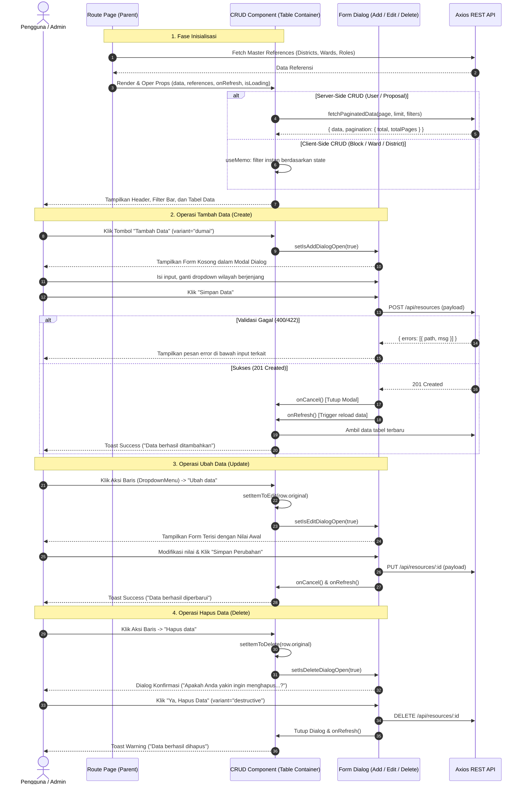

# Dokumentasi Komprehensif: Arsitektur & Perilaku Single Page CRUD

Dokumen ini merupakan panduan teknis tunggal (_Single Page CRUD Documentation_) yang merinci seluruh perilaku standar, siklus hidup, dan interaksi komponen pada setiap halaman CRUD (**Create, Read, Update, Delete**) di dalam aplikasi Admin Panel e-Musrenbang Kota Dumai (`emus-client`).

Semua modul CRUD dalam sistem—termasuk **RT ([`block.tsx`](file:///c:/Users/admin/.gemini/antigravity/scratch/musrenbang/client/src/components/block.tsx))**, **Kelurahan ([`ward.tsx`](file:///c:/Users/admin/.gemini/antigravity/scratch/musrenbang/client/src/components/ward.tsx))**, **Kecamatan ([`district.tsx`](file:///c:/Users/admin/.gemini/antigravity/scratch/musrenbang/client/src/components/district.tsx))**, **Pengguna ([`user.tsx`](file:///c:/Users/admin/.gemini/antigravity/scratch/musrenbang/client/src/components/user.tsx))**, **Usulan ([`proposal.tsx`](file:///c:/Users/admin/.gemini/antigravity/scratch/musrenbang/client/src/components/proposal.tsx))**, dan **Profil Lingkungan ([`block-profile.tsx`](file:///c:/Users/admin/.gemini/antigravity/scratch/musrenbang/client/src/components/block-profile.tsx))**—dibangun mengikuti pola arsitektur terpadu ini.

---

## Daftar Isi

1. [Prinsip Desain Single Page CRUD](#1-prinsip-desain-single-page-crud)
2. [Diagram Alur & Siklus Hidup CRUD](#2-diagram-alur--siklus-hidup-crud)
3. [Arsitektur Struktur Komponen & Props](#3-arsitektur-struktur-komponen--props)
4. [Perilaku Penyaringan Data (Filtering & Search)](#4-perilaku-penyaringan-data-filtering--search)
5. [Perilaku Tabel Data (TanStack Table)](#5-perilaku-tabel-data-tanstack-table)
6. [Perilaku & Standar Tombol (Buttons Behaviour)](#6-perilaku--standar-tombol-buttons-behaviour)
7. [Perilaku Dialog Modal (Dialogs Lifecycle)](#7-perilaku-dialog-modal-dialogs-lifecycle)
8. [Perilaku Formulir (Forms Architecture & Validation)](#8-perilaku-formulir-forms-architecture--validation)
9. [Perilaku Notifikasi & Umpan Balik (Toast & Loading)](#9-perilaku-notifikasi--umpan-balik-toast--loading)
10. [Daftar Lengkap Fungsi & Handler Standar](#10-daftar-lengkap-fungsi--handler-standar)
11. [Matriks Perbandingan Antar Halaman CRUD](#11-matriks-perbandingan-antar-halaman-crud)

---

## 1. Prinsip Desain Single Page CRUD

Konsep **Single Page CRUD** dalam aplikasi ini memastikan seluruh operasi data terjadi pada satu tampilan tanpa reload halaman (_zero full-page reloads_):

1. **Tidak Ada Navigasi Halaman untuk Tambah/Ubah**: Operasi _Create_ dan _Update_ selalu menggunakan **Modal Dialog** ([`Dialog`](file:///c:/Users/admin/.gemini/antigravity/scratch/musrenbang/client/src/components/ui/dialog.tsx)), sehingga konteks posisi filter dan tabel pengguna tidak hilang.
2. **Konfirmasi Penghapusan Terisolasi**: Operasi _Delete_ memicu dialog konfirmasi interaktif dengan peringatan destruktif.
3. **Penyegaran Data Reaktif (_Reactive Re-fetching_)**: Setelah operasi mutasi (Create, Edit, Delete) sukses di backend, dialog ditutup dan fungsi callback `onRefresh()` langsung memicu pembaruan tabel secara asinkron.
4. **Isolasi State**: State formulir terisolasi di dalam komponen masing-masing di direktori [`src/components/forms/`](file:///c:/Users/admin/.gemini/antigravity/scratch/musrenbang/client/src/components/forms/), menjaga komponen tabel utama tetap ramping.

---

## 2. Diagram Alur & Siklus Hidup CRUD

Berikut diagram komprehensif bagaimana setiap halaman CRUD beroperasi mulai dari inisialisasi hingga mutasi data:



---

## 3. Arsitektur Struktur Komponen & Props

Setiap halaman CRUD memiliki struktur hierarki 3 lapis:

### 1. Komponen Rute Induk (_Route Parent_)

Berada di `src/routes/` (misal: [`pengguna.tsx`](file:///c:/Users/admin/.gemini/antigravity/scratch/musrenbang/client/src/routes/pengguna.tsx), [`wilayah-administrasi.index.tsx`](file:///c:/Users/admin/.gemini/antigravity/scratch/musrenbang/client/src/routes/master/wilayah-administrasi.index.tsx)).

- **Tugas**:
  - Menjalankan guard autentikasi `beforeLoad: isAuthenticated()`.
  - Mengambil data referensi relasional (kecamatan, kelurahan, role) via `Promise.all`.
  - Menyediakan layout admin ([`AppSidebar`](file:///c:/Users/admin/.gemini/antigravity/scratch/musrenbang/client/src/components/app-sidebar.tsx), Header, Breadcrumb).
  - Melewatkan data referensi dan fungsi `onRefresh` ke komponen anak.

### 2. Komponen Pengelola CRUD (_Main CRUD Component_)

Berada di `src/components/` (misal: [`block.tsx`](file:///c:/Users/admin/.gemini/antigravity/scratch/musrenbang/client/src/components/block.tsx), [`user.tsx`](file:///c:/Users/admin/.gemini/antigravity/scratch/musrenbang/client/src/components/user.tsx)).

- **Tugas**:
  - Mengelola instansiasi TanStack Table (`useReactTable`).
  - Mengelola state filter (pencarian teks dan select filter).
  - Mengelola visibilitas dialog (Add, Edit, Delete).
  - Mengelola objek aktif yang sedang dipilih (`itemToEdit`, `itemToDelete`).
  - Merender header halaman, toolbar filter, tabel data, pagination, dan 3 buah modal dialog.

### 3. Komponen Formulir Terisolasi (_Isolated Form Components_)

Berada di `src/components/forms/` (misal: [`add-user.tsx`](file:///c:/Users/admin/.gemini/antigravity/scratch/musrenbang/client/src/components/forms/add-user.tsx), [`edit-user.tsx`](file:///c:/Users/admin/.gemini/antigravity/scratch/musrenbang/client/src/components/forms/edit-user.tsx)).

- **Tugas**:
  - Mengelola controlled state `formData`.
  - Menangani cascading dropdown (reset otomatis anak saat induk berubah).
  - Validasi form di client dan pemetaan pesan error dari server.
  - Mengirim mutasi HTTP (`POST` / `PUT`) dan memanggil callback `onCancel()` serta `onRefresh()`.

---

## 4. Perilaku Penyaringan Data (Filtering & Search)

Aplikasi menerapkan dua paradigma penyaringan data:

### Paradigma A: Draft vs Active Filtering (Server-Side CRUD)

Diterapkan pada **Pengguna** ([`user.tsx`](file:///c:/Users/admin/.gemini/antigravity/scratch/musrenbang/client/src/components/user.tsx)) dan **Usulan** ([`proposal.tsx`](file:///c:/Users/admin/.gemini/antigravity/scratch/musrenbang/client/src/components/proposal.tsx)) untuk menghemat beban server:

```typescript
// 1. State Filter Aktif (yang dikirim ke query string API)
const [activeFilterRoleId, setActiveFilterRoleId] = useState<string>("all")
const [activeSearchQuery, setActiveSearchQuery] = useState("")

// 2. State Filter Draft (yang terhubung ke input UI sebelum dikonfirmasi)
const [draftFilterRoleId, setDraftFilterRoleId] = useState<string>("all")
const [draftSearchQuery, setDraftSearchQuery] = useState("")

// 3. Status Perubahan
const hasFilterChanges = draftFilterRoleId !== activeFilterRoleId || draftSearchQuery !== activeSearchQuery
const hasActiveFilters = activeFilterRoleId !== "all" || activeSearchQuery !== ""
```

**Perilaku Interaksi:**

1. Pengguna mengetik atau memilih dropdown $\rightarrow$ mengubah `draft*` saja, tabel **tidak langsung refetch**.
2. Tombol **"Cari data"** otomatis `disabled` jika `!hasFilterChanges`. Tombol menjadi aktif hanya jika ada input baru yang belum diterapkan.
3. Menekan tombol **"Cari data"** atau menekan tombol `Enter` pada keyboard mengeksekusi `applyFilters()`:
   - Menyalin `draft*` ke `active*`.
   - Mereset halaman pagination ke awal (`pageIndex: 0`).
   - Memicu pemanggilan API via `useCallback(fetchData)`.
4. Tombol **"Reset"** hanya muncul bila `hasActiveFilters === true`. Menekannya akan mengembalikan seluruh draft dan active state ke nilai awal dan mereset halaman ke indeks 0.
5. **Indikator Filter Aktif**: Di bawah filter bar, muncul badge pill kecil yang menunjukkan filter apa yang sedang aktif menyaring tabel (misal: `Pencarian: "Budi"` atau `Peran: Administrator`).

### Paradigma B: Real-Time Memoized Filtering (Client-Side CRUD)

Diterapkan pada **Kecamatan**, **Kelurahan**, **RT**, dan **Profil Lingkungan**:

```typescript
const [searchQuery, setSearchQuery] = useState("")
const [filterDistrictId, setFilterDistrictId] = useState("")
const [filterWardId, setFilterWardId] = useState("")

// Cascading Filter untuk Dropdown Kelurahan:
const tableFilteredWards = useMemo(() => {
  if (filterDistrictId) {
    return wards.filter(w => w.district_id === parseInt(filterDistrictId))
  }
  return wards
}, [filterDistrictId, wards])

// Filter Komprehensif Tabel:
const filteredBlocks = useMemo(() => {
  let result = blocks
  if (filterDistrictId) result = result.filter(b => b.district_id === parseInt(filterDistrictId))
  if (filterWardId) result = result.filter(b => b.ward_id === parseInt(filterWardId))
  if (searchQuery) result = result.filter(b => b.name.toLowerCase().includes(searchQuery.toLowerCase()))
  return result
}, [blocks, wards, filterDistrictId, filterWardId, searchQuery])
```

**Perilaku Interaksi:**

1. Pengguna mengetik atau memilih filter $\rightarrow$ tabel langsung menyaring data secara instan (_real-time zero latency_).
2. Memilih Kecamatan otomatis memfilter daftar pilihan pada dropdown Kelurahan. Jika Kecamatan diganti, filter Kelurahan otomatis di-reset (`setFilterWardId("")`).

---

## 5. Perilaku Tabel Data (TanStack Table)

### 1. Inisialisasi TanStack Table (`useReactTable`)

Tabel dikonfigurasi secara deklaratif:

- **Server-Side**:
  ```typescript
  const table = useReactTable({
    data: users,
    columns,
    pageCount, // Berasal dari response API
    state: { pagination },
    onPaginationChange: setPagination,
    getCoreRowModel: getCoreRowModel(),
    manualPagination: true,
  })
  ```
- **Client-Side**:
  ```typescript
  const table = useReactTable({
    data: filteredBlocks,
    columns,
    getCoreRowModel: getCoreRowModel(),
    getFilteredRowModel: getFilteredRowModel(),
    getPaginationRowModel: getPaginationRowModel(),
    initialState: { pagination: { pageSize: 10 } },
  })
  ```

### 2. Definisi Kolom & Cell Renderers (`ColumnDef<T>`)

Setiap tabel memiliki standar kolom seragam:

1. **Kolom Standar / Teks**: Jika nilai data kosong (`null` atau `undefined`), cell selalu mencetak string fallback `"-"`.
2. **Kolom Berjenjang / Relasi**:
   - Menghubungkan ID dengan data master induk (misal: mencari nama Kecamatan berdasarkan `district_id`).
   - Menyusun hierarki teks bertingkat (misal nama Kelurahan di atas, nama RT di bawahnya).
3. **Kolom Link / Detail**:
   - Pada tabel RT, cell RT membungkus nama dengan komponen TanStack `<Link>` menuju rute detail:
     ```tsx
     <Link to="/master/wilayah-administrasi/rt/$blockId" params={{ blockId: row.original.id.toString() }} className="text-primary font-medium">
       <div className="flex items-center">{row.original.name} <ArrowUpRight className="w-3 h-3 ml-1" /></div>
     </Link>
     ```
4. **Kolom Aksi Kanan (`id: "actions"`)**:
   - Ditata rata kanan (`text-right` / `meta: { align: 'right' }`).
   - Merender menu titik tiga vertikal (`EllipsisVertical`) yang membungkus opsi aksi.

### 3. Rendering Header, Body, & Status Khusus

- **Sticky Header**: `<TableHeader className="bg-muted sticky top-0">` menjaga header tetap terlihat saat data panjang.
- **Status Loading**: Jika `isLoading === true`, tabel menampilkan baris tunggal di tengah: `<TableCell colSpan={columns.length} className="h-24 text-center">Memuat data...</TableCell>`.
- **Status Data Kosong**: Jika data kosong setelah selesai dimuat, tabel menampilkan teks `"Tidak ada data."`.

### 4. Smart Pagination (Paginasi Pintar)

- **Ringkasan Teks**: Menampilkan keterangan rentang data yang akurat:
  `Menampilkan {start} - {end} dari {total} data`.
- **Tombol Sebelumnya & Selanjutnya**: Menggunakan `table.previousPage()` dan `table.nextPage()`, otomatis `disabled` saat berada di batas awal atau akhir.
- **Logika Penomoran Pintar dengan Elipsis (`...`)**:
  - Jika total halaman $\le 6$: Seluruh nomor halaman (1 sampai $N$) ditampilkan.
  - Jika total halaman $> 6$: Menampilkan halaman 1, disusul tanda `...`, lalu halaman di sekitar halaman aktif (`currentPage - 1` hingga `currentPage + 1`), tanda `...`, dan nomor halaman terakhir.
  - Halaman aktif diberi style `variant="default"`, halaman lain `variant="outline"`.

---

## 6. Perilaku & Standar Tombol (Buttons Behaviour)

| Jenis Tombol                 | Letak / Posisi                           | Komponen & Variasi                                               | Status / State Khusus                                      | Perilaku Saat Diklik                                                                       |
| ---------------------------- | ---------------------------------------- | ---------------------------------------------------------------- | ---------------------------------------------------------- | ------------------------------------------------------------------------------------------ |
| **Tambah Data**              | Pojok kanan atas toolbar halaman         | `<Button variant="dumai">` (Emerald)                             | Selalu aktif, `hover:cursor-pointer`                       | Membuka modal Add Dialog (`setIsAddDialogOpen(true)`).                                     |
| **Cari Data**                | Di samping input search                  | `<Button variant="secondary">` + Icon `Search`                   | `disabled={!hasFilterChanges}`                             | Menerapkan draft filter ke active filter dan mereset halaman ke indeks 0.                  |
| **Reset Filter**             | Di sebelah kanan tombol cari             | `<Button variant="secondary">` + Icon `X`                        | Kondisional: hanya muncul jika `hasActiveFilters === true` | Menghapus seluruh filter, mengosongkan input, dan memuat ulang tabel dari halaman pertama. |
| **Aksi Baris (Row Trigger)** | Kolom paling kanan tabel                 | `<Button variant="ghost" size="icon">` + Icon `EllipsisVertical` | Muncul di setiap baris data                                | Membuka menu popover dropdown menu ke arah kiri bawah (`align="end"`).                     |
| **Opsi Ubah Data**           | Di dalam Dropdown Menu baris             | `<DropdownMenuItem>`                                             | Selalu ada untuk setiap baris                              | Mengisi state `itemToEdit = row.original` lalu membuka modal Edit Dialog.                  |
| **Opsi Hapus Data**          | Di dalam Dropdown Menu baris             | `<DropdownMenuItem>`                                             | Selalu ada untuk setiap baris                              | Mengisi state `itemToDelete = row.original` lalu membuka modal Delete Dialog.              |
| **Opsi Lihat Detail**        | Di dalam Dropdown Menu baris (khusus RT) | `<DropdownMenuItem>` dibungkus `<Link>`                          | Khusus entitas yang memiliki sub-halaman                   | Mengarahkan rute TanStack Router ke halaman profil/detail entitas.                         |
| **Simpan Form (Submit)**     | Footer modal form Add/Edit               | `<Button type="submit">`                                         | `disabled={isSubmitting \|\| !isFormValid}`                | Mengirim data ke backend. Label berubah menjadi _"Menyimpan..."_ saat proses berlangsung.  |
| **Batal Form**               | Footer modal form Add/Edit               | `<Button variant="outline" type="button">`                       | Selalu aktif                                               | Membatalkan input, memanggil `onCancel()`, dan menutup dialog modal.                       |
| **Konfirmasi Hapus**         | Footer modal Delete Confirmation         | `<Button variant="destructive">` (Merah)                         | `disabled={isDeleting}`                                    | Mengeksekusi HTTP `DELETE` ke backend, menampilkan toast warning, dan menyegarkan tabel.   |
| **Navigasi Halaman**         | Baris paginasi bawah                     | `<Button variant="outline" size="sm">`                           | `disabled={!table.getCanPreviousPage()}` atau `Next`       | Berpindah ke halaman sebelum/sesudah atau melompat ke nomor halaman yang diklik.           |

---

## 7. Perilaku Dialog Modal (Dialogs Lifecycle)

Setiap komponen CRUD memuat **3 Dialog Modal terpisah**:

### 1. Add Dialog Modal

```tsx
<Dialog open={isFormAddDialogOpen} onOpenChange={setIsFormAddDialogOpen}>
  <DialogContent className="sm:max-w-[425px]">
    <DialogHeader>
      <DialogTitle>Tambah {Entity}</DialogTitle>
      <DialogDescription>Isi form di bawah ini untuk menambahkan data baru</DialogDescription>
    </DialogHeader>
    <AddForm
      {...referenceProps}
      onRefresh={handleRefreshAfterCreate}
      onCancel={() => setIsFormAddDialogOpen(false)}
    />
  </DialogContent>
</Dialog>
```

- **Siklus Hidup**:
  1. Dibuka dengan mengklik tombol "Tambah [Entity]".
  2. Merender form dalam kondisi bersih (semua field kosong).
  3. Saat form berhasil disimpan, memanggil `onCancel()` (menutup dialog) dan `handleRefreshAfterCreate()` (mereset pagination ke halaman 1 dan mengambil data terbaru).

### 2. Edit Dialog Modal

```tsx
<Dialog open={isFormEditDialogOpen} onOpenChange={setIsFormEditDialogOpen}>
  <DialogContent className="sm:max-w-[425px]">
    <DialogHeader>
      <DialogTitle>Edit {Entity}</DialogTitle>
      <DialogDescription>Ubah data {entity}</DialogDescription>
    </DialogHeader>
    {itemToEdit && (
      <EditForm
        item={itemToEdit}
        {...referenceProps}
        onRefresh={handleRefreshAfterUpdate}
        onCancel={() => {
          setIsFormEditDialogOpen(false)
          setItemToEdit(null)
        }}
      />
    )}
  </DialogContent>
</Dialog>
```

- **Siklus Hidup**:
  1. Baru dirender ketika `itemToEdit !== null`.
  2. Form menginisialisasi `formData` menggunakan nilai `itemToEdit`.
  3. Saat sukses disimpan, memanggil `handleRefreshAfterUpdate()` yang memperbarui data **tanpa mereset halaman paginasi**, menjaga posisi pengguna tetap di halaman aktif saat ini.
  4. Saat ditutup/dibatalkan, state `itemToEdit` dibersihkan kembali menjadi `null`.

### 3. Delete Confirmation Dialog Modal

```tsx
<Dialog open={isDeleteDialogOpen} onOpenChange={setIsDeleteDialogOpen}>
  <DialogContent className="sm:max-w-[425px]">
    <DialogHeader>
      <DialogTitle>Hapus {Entity}</DialogTitle>
      <DialogDescription>
        Apakah Anda yakin ingin menghapus "{itemToDelete?.name}"? Tindakan ini tidak dapat dibatalkan.
      </DialogDescription>
    </DialogHeader>
    <div className="flex justify-end gap-2 mt-4">
      <Button variant="outline" onClick={() => setIsDeleteDialogOpen(false)}>Batalkan</Button>
      <Button variant="destructive" onClick={handleDelete}>Ya, Hapus Data</Button>
    </div>
  </DialogContent>
</Dialog>
```

- **Siklus Hidup**:
  1. Menampilkan nama entitas yang akan dihapus secara eksplisit pada deskripsi dialog.
  2. Tombol aksi berwarna merah (`destructive`) untuk mencegah penghapusan yang tidak disengaja.
  3. Setelah request `api.delete` berhasil, dialog ditutup, `itemToDelete` direset, tabel di-refresh, dan muncul toast peringatan kuning.

---

## 8. Perilaku Formulir (Forms Architecture & Validation)

### 1. Inisialisasi Controlled Form

Setiap form mengelola inputnya melalui `formData`:

```typescript
const [formData, setFormData] = useState({
  name: item?.name || "",
  district_id: item?.district_id?.toString() || "",
  ward_id: item?.ward_id?.toString() || "",
  address: item?.address || "",
  contact: item?.contact || "",
})
```

### 2. Cascading Wilayah & Dependensi Nilai

Saat dropdown tingkat atas berubah, sistem secara otomatis:

1. Menyaring pilihan dropdown tingkat di bawahnya.
2. Mereset nilai dropdown tingkat bawah tersebut ke string kosong untuk mencegah data yatim (_orphaned data_).

```typescript
useEffect(() => {
  if (formData.district_id) {
    setFilteredWards(wards.filter(w => w.district_id === formData.district_id))
    setFormData(prev => ({ ...prev, ward_id: "", block_id: "" }))
  } else {
    setFilteredWards([])
  }
}, [formData.district_id, wards])
```

### 3. Penyesuaian Dinamis Berdasarkan Scope Peran (RBAC Form)

Pada formulir pengguna ([`add-user.tsx`](file:///c:/Users/admin/.gemini/antigravity/scratch/musrenbang/client/src/components/forms/add-user.tsx)):

- Jika role memiliki `scope_level === 'district'`: Input yang dirender hanya **Kecamatan**.
- Jika role memiliki `scope_level === 'ward'`: Input yang dirender adalah **Kecamatan** dan **Kelurahan**.
- Jika role memiliki `scope_level === 'block'`: Input yang dirender adalah **Kecamatan**, **Kelurahan**, dan **RT**.
- Jika role bertaraf global (Kota): Seluruh kolom wilayah disembunyikan dan diabaikan dari payload.

### 4. Validasi Dua Tingkat (Two-Tier Validation)

1. **Validasi Klien (Client Pre-check)**:
   - Form memeriksa kelengkapan kolom wajib melalui getter `isFormValid`.
   - Tombol submit tetap disabled selama syarat form belum terpenuhi.
2. **Validasi Server (Backend Error Mapping)**:
   - Jika backend mengembalikan status HTTP `400` atau `422` dengan struktur array error Express Validator:
     ```json
     { "errors": [{ "path": "username", "msg": "Username sudah digunakan" }] }
     ```
   - Komponen memetakan error tersebut ke dalam state lokal `errors`:
     ```typescript
     const backendErrors = err.response.data.errors
     const fieldErrors: FieldErrors = {}
     backendErrors.forEach((error) => {
       if (error.path) fieldErrors[error.path] = error.msg
     })
     setErrors(fieldErrors)
     ```
   - Setiap komponen input memeriksa `errors[fieldName]`. Jika ada, batas input berubah menjadi merah dan pesan kesalahan dirender di bawah input:
     ```tsx
     {errors.username && <p className="text-sm text-destructive">{errors.username}</p>}
     ```

### 5. Siklus Penanganan Submit (`handleSubmit`)

```typescript
const handleSubmit = async (e: React.FormEvent) => {
  e.preventDefault()
  setIsSubmitting(true)
  setErrors({})

  try {
    await api.post('/endpoint', payload)
    toast.success("Data berhasil ditambahkan")
    onCancel()       // 1. Tutup modal
    await onRefresh() // 2. Muat ulang tabel di background
  } catch (err: any) {
    if (err.response?.data?.errors) {
      // Tangani error validasi spesifik kolom
    } else {
      toast.error(err.response?.data?.message || "Gagal menyimpan data")
    }
  } finally {
    setIsSubmitting(false)
  }
}
```

---

## 9. Perilaku Notifikasi & Umpan Balik (Toast & Loading)

Sistem menggunakan pustaka notifikasi **Sonner** (`toast` dari `sonner`) dengan kontainer global `<Toaster richColors position="bottom-right" />`:

1. **Loading Feedback Saat Mengambil Data**:
   - Pada pemanggilan data server-side, sistem dapat memicu `const toastId = toast.loading('Memuat data...')`.
   - Setelah selesai, ID toast tersebut di-dismiss (`toast.dismiss(toastId)`).
2. **Operasi Tambah / Update**:
   - `toast.success("Data berhasil ditambahkan")` (notifikasi hijau dengan tanda centang).
3. **Operasi Hapus**:
   - `toast.warning("Data berhasil dihapus")` (notifikasi oranye/kuning).
4. **Operasi Gagal**:
   - `toast.error("Gagal memuat data")` atau `toast.error(pesan_dari_server)` (notifikasi merah).

---

## 10. Daftar Lengkap Fungsi & Handler Standar

Tabel berikut merangkum seluruh fungsi yang wajib ada di setiap berkas Single Page CRUD:

| Kategori Fungsi    | Nama Fungsi / Handler        | Parameter                                    | Deskripsi & Tujuan                                                               |
| ------------------ | ---------------------------- | -------------------------------------------- | -------------------------------------------------------------------------------- |
| **Props**          | `Component(props)`           | `{ data, references, onRefresh, isLoading }` | Menerima data dan dependensi dari parent route.                                  |
| **Memo / Compute** | `filteredData`               | `[data, searchQuery, filters]`               | Menghitung array data tabel setelah disaring oleh filter bar.                    |
| **Memo / Compute** | `tableFilteredWards`         | `[filterDistrictId, wards]`                  | Menghitung daftar kelurahan yang valid berdasarkan kecamatan terpilih.           |
| **Fetch**          | `fetchData()`                | `useCallback`                                | Memanggil endpoint API dengan query params pagination & filter.                  |
| **Filter**         | `applyFilters()`             | `void`                                       | Menerapkan draft search/filter ke active filter dan mereset ke halaman 1.        |
| **Filter**         | `resetFilters()`             | `void`                                       | Mengosongkan seluruh filter dan mengembalikan tabel ke kondisi awal.             |
| **Dialog Control** | `openEditDialog(item)`       | `(item: T) => void`                          | Menetapkan `itemToEdit = item` dan membuka dialog edit (`true`).                 |
| **Dialog Control** | `openDeleteDialog(item)`     | `(item: T) => void`                          | Menetapkan `itemToDelete = item` dan membuka dialog konfirmasi hapus (`true`).   |
| **CRUD Handler**   | `handleDelete()`             | `async () => void`                           | Mengirim request `DELETE /api/:id`, menutup dialog, dan memanggil `onRefresh()`. |
| **CRUD Handler**   | `handleRefreshAfterCreate()` | `async () => void`                           | Mereset pagination ke halaman 1 (`pageIndex: 0`) dan memanggil `fetchData()`.    |
| **CRUD Handler**   | `handleRefreshAfterUpdate()` | `async () => void`                           | Menyegarkan data tabel pada halaman pagination yang sedang aktif.                |
| **Cell Renderer**  | `District / Ward Cell`       | `({ row }) => JSX/string`                    | Mengubah foreign ID menjadi nama entitas induk yang mudah dibaca.                |
| **Cell Renderer**  | `Actions Cell`               | `({ row }) => JSX`                           | Merender tombol trigger titik tiga dan menu dropdown aksi baris.                 |
| **Form Handler**   | `handleSubmit(e)`            | `(e: FormEvent) => Promise<void>`            | Mengirim payload form ke API, menampilkan toast, dan menutup dialog.             |

---

## 11. Matriks Perbandingan Antar Halaman CRUD

| Halaman CRUD          | Berkas Komponen Utama                                                                                                                       | Model Paginasi            | Tipe Filter      | Cascading Wilayah                                          | Fitur Khusus Baris                                                                                                                                                                |
| --------------------- | ------------------------------------------------------------------------------------------------------------------------------------------- | ------------------------- | ---------------- | ---------------------------------------------------------- | --------------------------------------------------------------------------------------------------------------------------------------------------------------------------------- |
| **Data RT**           | [`src/components/block.tsx`](file:///c:/Users/admin/.gemini/antigravity/scratch/musrenbang/client/src/components/block.tsx)                 | Client-Side (10 per page) | Instant Memoized | Kecamatan $\rightarrow$ Kelurahan                          | Tautan langsung ke detail profil RT ([`$blockId`](file:///c:/Users/admin/.gemini/antigravity/scratch/musrenbang/client/src/routes/master/wilayah-administrasi_.rt.$blockId.tsx)). |
| **Data Kelurahan**    | [`src/components/ward.tsx`](file:///c:/Users/admin/.gemini/antigravity/scratch/musrenbang/client/src/components/ward.tsx)                   | Client-Side (10 per page) | Instant Memoized | Filter Kecamatan                                           | Pencarian instan nama kelurahan.                                                                                                                                                  |
| **Data Kecamatan**    | [`src/components/district.tsx`](file:///c:/Users/admin/.gemini/antigravity/scratch/musrenbang/client/src/components/district.tsx)           | Client-Side (10 per page) | Instant Memoized | -                                                          | CRUD master kecamatan murni.                                                                                                                                                      |
| **Data Pengguna**     | [`src/components/user.tsx`](file:///c:/Users/admin/.gemini/antigravity/scratch/musrenbang/client/src/components/user.tsx)                   | Server-Side (API params)  | Draft vs Active  | Kecamatan $\rightarrow$ Kelurahan $\rightarrow$ RT         | Penugasan peranan & wilayah dinamis (_Territory Scope_).                                                                                                                          |
| **Data Usulan**       | [`src/components/proposal.tsx`](file:///c:/Users/admin/.gemini/antigravity/scratch/musrenbang/client/src/components/proposal.tsx)           | Server-Side (API params)  | Draft vs Active  | Tahun + Kecamatan $\rightarrow$ Kelurahan $\rightarrow$ RT | Tampilan kode usulan, uraian masalah, dan pagu anggaran.                                                                                                                          |
| **Profil Lingkungan** | [`src/components/block-profile.tsx`](file:///c:/Users/admin/.gemini/antigravity/scratch/musrenbang/client/src/components/block-profile.tsx) | Client-Side (10 per page) | Instant Memoized | Kategori Profil                                            | Master indikator (Infrastruktur, Demografi, Ekonomi, dll).                                                                                                                        |

---

## Ringkasan Alur Pembuatan Halaman CRUD Baru

Jika Anda ingin membuat modul CRUD baru di masa depan, cukup ikuti 5 langkah standar berikut:

1. **Buat Rute**: Tambahkan file rute di `src/routes/` dengan guard `beforeLoad: isAuthenticated()` dan `Promise.all` untuk data awal.
2. **Buat Komponen Pengelola Tabel**: Di `src/components/`, buat komponen utama yang menerima props data, inisialisasi `useReactTable`, siapkan kolom dan cell dropdown aksi.
3. **Tambahkan Trio Modal Dialog**: Letakkan `Dialog` untuk Add, Edit, dan Delete di bagian bawah return JSX komponen utama.
4. **Buat Formulir di `src/components/forms/`**: Pisahkan `add-[entity].tsx` dan `edit-[entity].tsx` dengan mengimplementasikan controlled state, pemetaan error server, dan callback `onRefresh` serta `onCancel`.
5. **Koneksikan Feedback**: Pasang notifikasi `toast.success`, `toast.warning`, dan `toast.error` dari pustaka Sonner.
